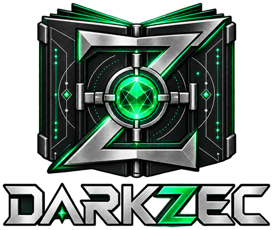
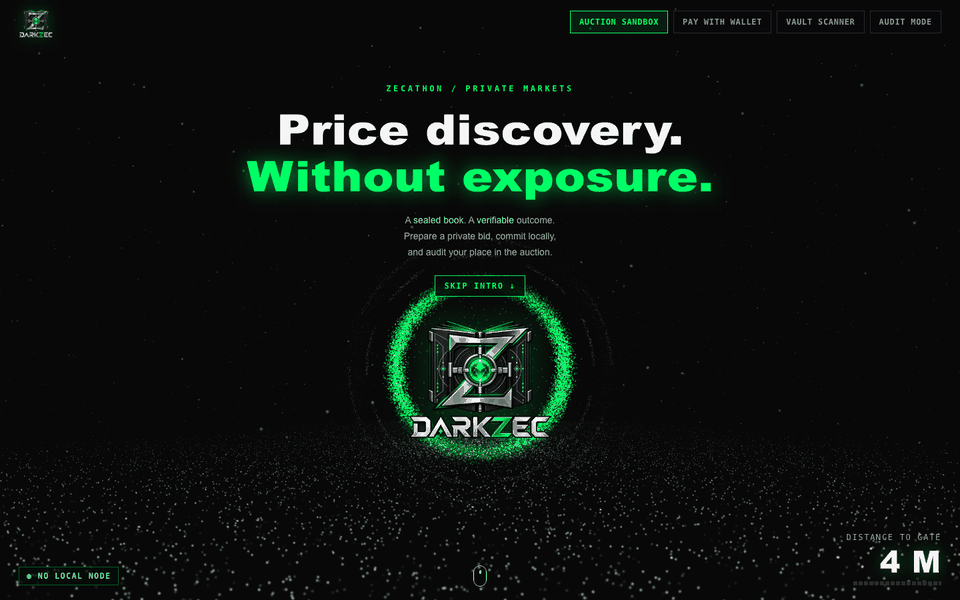
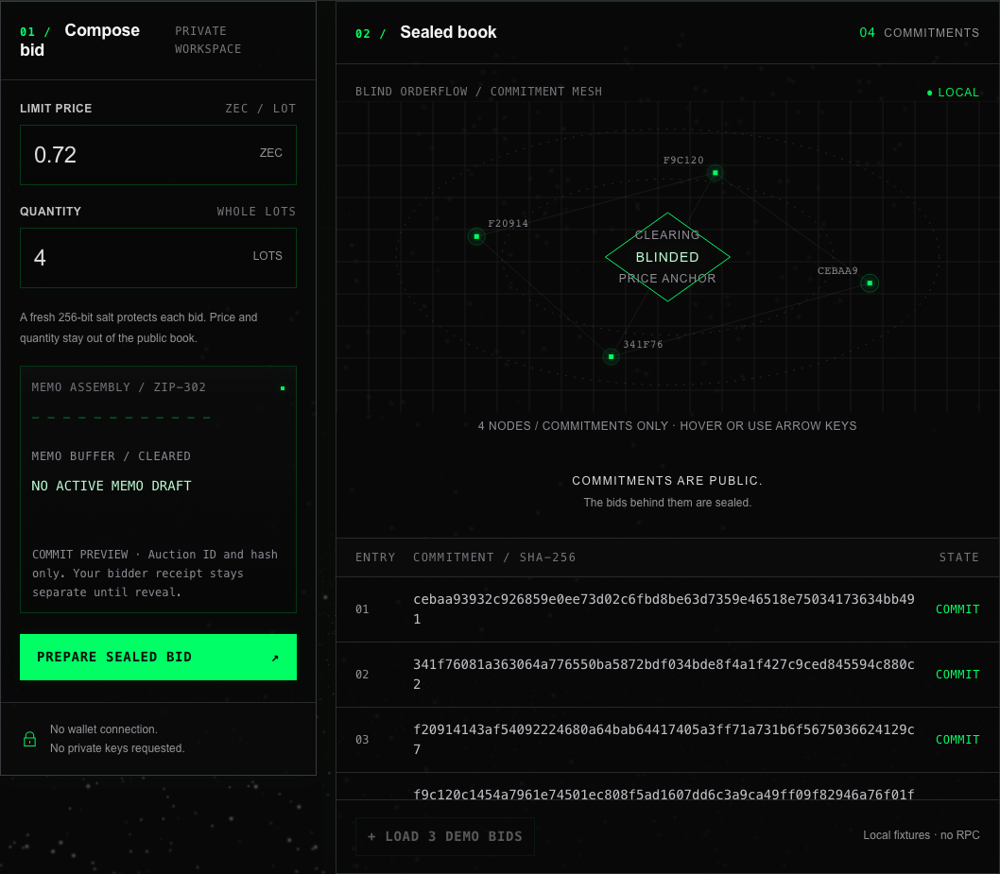
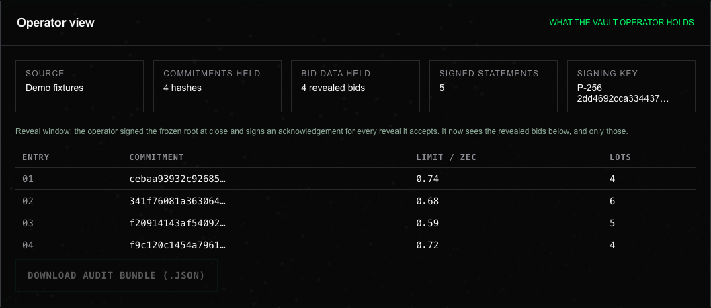
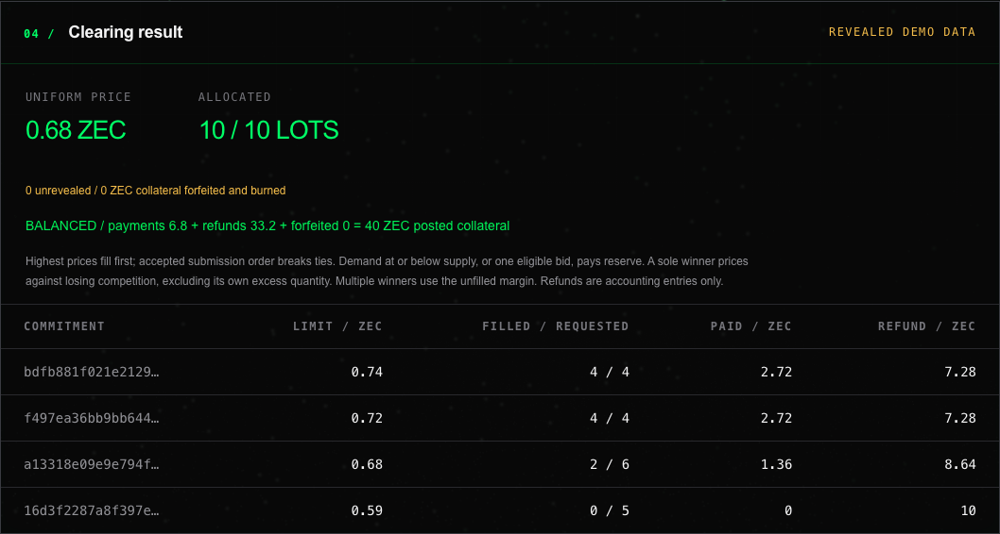
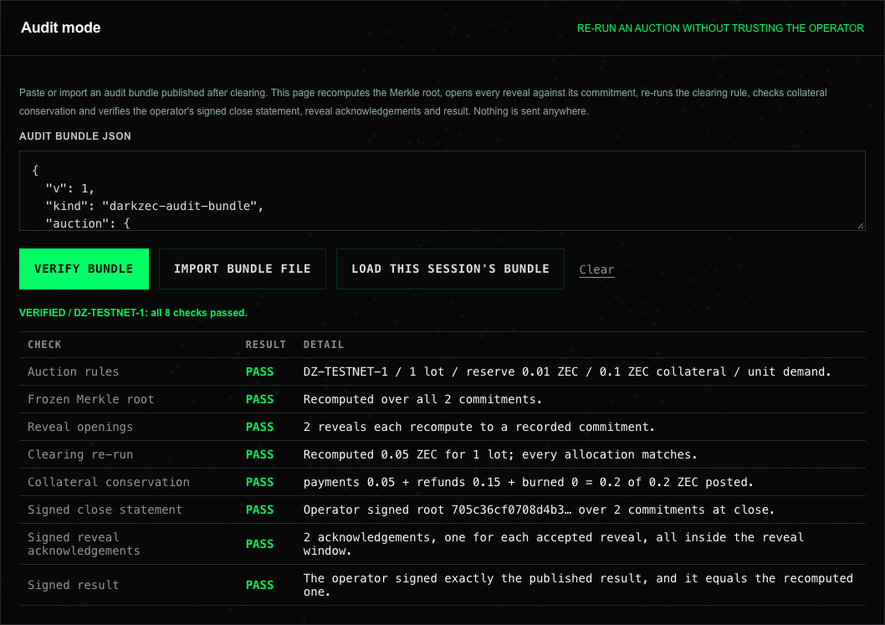

<p align="center"></p>

# DarkZec // Sealed-Bid Auctions on Zcash


**Private order submission. Deterministic price discovery. Verifiable inclusion.**

**Live demo: [darkzec.xyz](https://darkzec.xyz)** — the static build of `main`. The auction, operator view, audit mode (including the settled testnet runs), wallet requests and the training vault all run there; testnet payment checks and live testnet auctions read a local Zcash wallet, so they need the local server below.

**Proven on testnet, settled on chain: [DZ-TESTNET-1, 2 and 3](docs/testnet-run/README.md)** — complete auctions on the public Zcash testnet: commits and reveals paid as shielded memos and imported from the chain, cleared at the Vickrey second price, then **settled in one on-chain transaction** (refunds, seller proceeds and a burned forfeit). DZ-TESTNET-3 ran entirely **through a shareable auction link** with block-height deadlines. Each vault's viewing key is published, so anyone can check every deposit and payout on chain: **12 of 12 audit checks**. See [settlement and trust model](docs/settlement.md).

DarkZec is a browser-local market terminal for **commit/reveal sealed-bid auctions** paid to Orchard receivers and settled in Zcash's shielded Ironwood pool. Built for **ZECATHON — Track: Private Markets**. A bidder commits a salted hash plus fixed collateral, reveals the private bid in a short window, and any participant can verify that their commitment is in the frozen Merkle root.

[Judge path](#judge-path-60-seconds) · [Run a real auction](#run-a-real-auction) · [Quick start](#local-development) · [Judge walkthrough](#judge-walkthrough) · [What is real vs mock](#what-is-real-and-what-is-mock) · [ZIP compliance](#core-architecture--zip-compliance) · [Clearing and audit](#clearing-engine--merkle-audit) · [Threat model](#threat-model) · [Security boundaries](#security--privacy-boundaries)

## Judge path (60 seconds)

<p align="center"></p>

1. Open **[darkzec.xyz](https://darkzec.xyz)** and choose **Skip intro**.
2. **+ Load 3 demo bids**, then **Prepare sealed bid** and **Commit to local vault**. The book holds four hashes; **Operator view** reads *Bid data held: None*.
3. **Close auction** (the operator signs the frozen root), then **Reveal all local receipts / demo** (each reveal gets a signed acknowledgement; only now does the operator see bids).
4. **Finalize & clear**: `0.68 ZEC`, `10 / 10` lots and a green `BALANCED` conservation line.
5. **Audit mode** has ready-made examples at the top (the three real testnet auctions, and a tampered copy that must fail). On your own session, **Load this session's bundle**: all 8 checks pass. Edit the clearing price in the JSON and verify again: the clearing re-run and the result signature fail.
6. **Real chain:** in Audit mode choose **Load DZ-TESTNET-2 (real testnet)**: a settled auction on the public Zcash testnet ([txids](docs/testnet-run/README.md)). All 10 checks pass, including *Deposits on chain* and *Settlement on chain*. On the public site those two use the chain snapshot recorded at verification and the verdict says so; on a local server they read testnet live, and `npm run verify-chain -- public/testnet/DZ-TESTNET-2-audit-bundle.json` does the same from the command line.
7. **Vault scanner** → **Load DZ-TESTNET-2 published key**: every note the vault received (commits, reveals) and every payment it made (refunds, proceeds, burn).
8. **Practice as a seller:** open the sandbox's **Run this auction…** panel, press **Practice with a simulated chain** and follow the six hints (simulate payments, advance, sync, close, reveal, clear). Then open the practice link in another tab for the bidder page, and **Load this session's bundle** in Audit mode (10 checks).
9. **A real auction link:** open the [DZ-TESTNET-3 link](docs/testnet-run/README.md#dz-testnet-3-a-real-auction-run-from-its-link). The bidder page shows the operator-signed rules, the block deadlines and the vault; **Load the published result and the winner's receipt** re-runs the audit in your browser (12 checks, the on-chain ones from the recorded snapshot) and shows the winner's outcome and refund.

| Sealed book: hashes only | Operator view after reveal |
| --- | --- |
|  |  |
| **Clearing result and conservation check** | **Audit mode on the real testnet auction** |
|  |  |

Screenshots are regenerated with `node scripts/capture-media.ts` against a running build.

## Run a real auction

A seller describes what is for sale, picks the rules and gets **one link**; bidders open it on darkzec.xyz, pay with their own shielded wallet and later check their result. No account, no server of ours in the loop.

1. **Seller** (`npm run auction -- --wallet <dir>`: one command that checks the setup, keeps the wallet synced and serves the page): title, description, vault, mode, lots, reserve, collateral, and how long bidding and reveals stay open. The page turns durations into **block heights**, signs the listing with the session key, downloads an **encrypted operator key file** and returns the link. A lost tab is not fatal: **Resume** rebuilds the auction from the link, the key file and the chain.
2. **Bidder:** the link shows the signed rules, the deadlines and the vault. *Bid on this auction* opens the wallet tab locked to the listing; scan the QR, pay the collateral, later pay the reveal.
3. **Anyone:** the audit bundle re-runs the auction, and a view-only wallet built from the published viewing key checks every payment on chain, including that **no on-time commit or acceptable reveal was left out** and **no late one was admitted**.

**No wallet? Practice on the public site:** press *Practice with a simulated chain* in the seller panel; the buttons play three bidders and everything else is the real flow, ending in the real audit.

Modes: uniform price, unit demand, Vickrey, and **procurement** (a buyer collects sealed offers; the lowest win at the next-lowest price and bids are bonds returned whole). The link carries everything inside its URL fragment, which browsers never send to a server. Full walkthrough, limits and the trust model: [auction links](docs/auction-links.md), [settlement](docs/settlement.md).

## What is real and what is mock

| Capability | Status |
| --- | --- |
| ZIP-316 Unified Address validation (Bech32m, F4Jumble, receiver ordering, Orchard point check) | **Real**, tested against official vectors. Mixed wallet UAs are accepted and projected to Orchard-only destinations. |
| ZIP-302 memo sizing (exact UTF-8 ≤ 512 bytes) and ZIP-321 `zcash:` URI generation (unpadded Base64url) | **Real**. |
| Salted, domain-separated bid commitments and SHA-256 Merkle inclusion proofs | **Real**, computed locally with Web Crypto. |
| Memo round trip: verify a commit memo copied from a real wallet against your prepared request; reveal receipt download/import | **Real**, local checks (see [testnet round trip](docs/testnet-interop.md)). |
| Local Zcash testnet payment check | **Real read-only wallet check** for a confirmed shielded note at the vault's Orchard receiver (Ironwood pool) with the exact collateral tier and commit memo; user-triggered, local node only. |
| Live testnet auction | **Real** commit and reveal ingestion from confirmed shielded memos (Ironwood pool) at a vault the local wallet views (read-only RPC). Commits enter the ledger oldest first; reveals arrive as a second shielded memo. |
| Auction links, block-height deadlines, procurement mode | **Real**: operator-signed listings in a URL fragment, deadlines as block heights checked on chain (no late payment admitted, no on-time one dropped), a bidder page with one-click result check and calendar reminders, a reverse (procurement) mode, an encrypted operator key file with resume-from-chain, and a practice mode on a simulated chain. [Details](docs/auction-links.md). There is no hosted operator service: the operator runs `npm run auction` locally. |
| Co-signer policy for settlement | **Real, as a building block**: `npm run cosign-check` re-verifies the audit bundle and approves a settlement request only if it pays exactly the refunds, proceeds and burn the result implies; `npm run settle` applies it to itself. The threshold (FROST) key and signing are **not implemented**; see the [trust model](docs/assets/trust-model.svg) and [settlement](docs/settlement.md#next-step-threshold-custody-with-frost). |
| On-chain settlement and public verification | **Real on testnet**: `npm run settle` pays every refund, the seller proceeds and the forfeit burn (to a provably unspendable P2SH(OP_RETURN) address) in one transaction from the auction's own vault account, then publishes that account's viewing key. `npm run verify-chain` and Audit mode on a local server rebuild a view-only wallet from the key and check every deposit and payout on chain ([details](docs/settlement.md)). |
| Operator signatures and audit mode | **Real**: ECDSA P-256 signatures over the frozen root at close, every accepted reveal and the result; an exportable audit bundle that any browser re-verifies in eight checks, plus two on-chain checks once the auction is settled. The signing key is per session and not bound to an identity. |
| Collateral tiers and unit-demand mode | **Real**: 0.1, 1, 10 or 100 ZEC per auction; unit-demand auctions clear at the truthful (k+1)-th price (Vickrey for one lot). |
| Commit/reveal ledger, uniform-price clearing and zatoshi-exact collateral/refund accounting | **Real** local engine; on testnet its result is settled on chain as above. In the browser sandbox nothing moves. |
| Vault scanner | **Real on testnet**: paste a unified full viewing key and the local server's view-only light wallet lists every note received and payment made. Below it, a **training vault** with `mock:node07:` keys and simulated notes is kept for practising the unlock and quarantine flow; it never touches the chain. |
| Escrow that prevents the operator from keeping collateral (threshold custody), in-browser trial decryption, external root anchoring, mainnet | **Not implemented.** The operator holds collateral until settlement; misbehaviour is provable, not prevented. The FROST design is in [settlement](docs/settlement.md#next-step-threshold-custody-with-frost). Mainnet stays disabled until that and a security review exist. |
| Zodl Wallet handoff | Standard `zcash:` request; installed-wallet compatibility needs device testing. |
| QR rendering | **Real**: ZIP-321 requests drawn as QR codes in the browser, decoded back in tests. |

No funds move in the Judge Sandbox. The build has not had an independent security audit.

> **Not safe for real funds.** The operator's wallet holds the collateral and can spend it alone: the co-signer policy is a building block, not custody, and threshold signing is not implemented. Mainnet stays disabled for this reason. Everything runs on Zcash testnet, whose coins have no value.

## Why sealed bids

Public orderflow can reveal a trader's limits, size, timing and address relationships before a trade completes, which enables front-running, inventory inference and counterparty profiling. DarkZec keeps bid instructions out of the public book: during the commit phase only an auction ID and a salted hash travel in the shielded memo. Prices, quantities and refund addresses stay with the bidder until the reveal window, and the clearing service publishes only the clearing result plus an inclusion root.

Shielding reduces on-chain disclosure; it does not erase every metadata channel. Timing, pool crossings, wallet behavior and cross-chain endpoints still matter. The vault operator sees revealed bids, so privacy against public observers and confidentiality from the operator are distinct properties.

**Scope, plainly.** DarkZec is one sealed-bid batch auction per vault account, run by one operator: bids are collected, the auction closes, and it clears once at a uniform price. It is not a continuous dark pool, an order-matching engine or an OTC desk.

## Core architecture & ZIP compliance

```text
COMMIT   bid inputs -> canonical JSON + fresh salt -> salted SHA-256 commitment
         commit memo {v:2,t:"commit",a,c} (auction ID + hash, <= 512 bytes)
         ZIP-321 request for an Orchard-only vault + fixed collateral -> wallet review
CLOSE    freeze ordered commitments -> Merkle root over ALL commitments
REVEAL   bidder submits the private receipt {a,p,q,s,r} -> ledger recomputes the hash
CLEAR    verified reveals only -> uniform-price clearing -> payment/refund accounting

Local only, no chain dependency:
  encrypted mock notes -> viewing-key vault -> authenticate -> parse commit memo
Fixed event metadata -> shared audit store -> terminal stream + telemetry rail
```

The sandbox auction and the vault scanner are isolated: scanned mock notes never enter the auction book. The wallet builder produces a payment instruction; it does not confirm payment or deposit a bid into the local book. The governing repository policy is [DARKZEC-STANDARD.md](DARKZEC-STANDARD.md); implementation lives in [src/protocol/](src/protocol/), [src/simulation.ts](src/simulation.ts) and [src/lib/](src/lib/).

### ZIP-316: Orchard-only payment instructions

A `u1…` prefix alone does not establish Orchard support. DarkZec accepts standard wallet UAs containing a valid Orchard receiver (Sapling and transparent companions allowed) and rebuilds an Orchard-only UA for the payment URI and refund destination, so no transparent fallback is generated. Bare transparent addresses and UAs without Orchard are refused. Supported encodings are Revision 0 `u1…` (mainnet) and `utest1…` (testnet). The validator checks Bech32m, inverse F4Jumble, HRP padding, canonical CompactSize, receiver ordering/length and a valid nonidentity Orchard payment point. Refund and vault must resolve to different Orchard receivers even when their UA strings differ. See [ZIP-316](https://zips.z.cash/zip-0316).

**Ironwood routing (NU6.3).** Since NU6.3, ordinary payments inside the old Orchard pool are disabled and a payment to an Orchard receiver in a Unified Address settles in the new Ironwood pool ([ZIP 318](https://zips.z.cash/zip-0318)). The receiver and its encoding are unchanged, so DarkZec's Orchard-only requests stay valid; they simply land in Ironwood. The payment checker and the live auction therefore accept vault notes from the Ironwood pool as well as legacy Orchard-pool notes, and still refuse Sapling and transparent ones.

### ZIP-302: memos within 512 bytes

Two canonical JSON shapes are used, both validated as exact UTF-8 byte length (`new TextEncoder().encode(json).length <= 512`, so exactly 512 passes):

| Shape | Fields | Where it goes |
| --- | --- | --- |
| Commit memo | `v:2`, `t:"commit"`, `a` auction ID, `c` 64-hex commitment | Payment URI memo / shielded note. Public data only. |
| Reveal receipt | `v:1`, `a`, `p` price, `q` quantity, `s` 64-hex salt, `r` Orchard refund UA | Held privately by the bidder; in the reveal window it is submitted locally or sent as the memo of a second shielded payment (0.0001 ZEC) to the vault. |

Invalid Unicode, noncanonical JSON, wrong versions and extra fields are rejected. JSON itself provides no encryption; the wallet creates the encrypted note. See [ZIP-302](https://zips.z.cash/zip-0302).

### ZIP-321: payment requests and wallet handoff

```text
zcash:<orchard-only-UA>?amount=<collateral-ZEC>&memo=<unpadded-Base64url(commit memo)>
```

The URI is a readable instruction, but it carries only the auction ID and commitment hash. The reveal receipt is the sensitive artifact: it holds price, quantity, salt and refund address, and the UI shows it separately. Editing an input erases the previous request and acknowledgement; **Open wallet** activates only after destination, network and escrow review, and public demo receivers are refused. Remote QR services would violate the zero-external-request boundary, so QR rendering is left out. See [ZIP-321](https://zips.z.cash/zip-0321).

## Clearing engine & Merkle audit

The local auction follows `open -> reveal -> cleared`:

1. **Commit:** accept only `{auctionId, commitment, collateral}`; collateral is fixed (10 ZEC per commitment), duplicates are refused, and the sandbox holds up to 128 commitments. No preimage enters the ledger.
2. **Close:** stop commits, freeze the ordered commitment set and publish the Merkle root over **all** commitments. A 60-second reveal window starts.
3. **Reveal:** the bidder submits the receipt; the ledger rebuilds the memo, rejects refund-to-vault, recomputes the commitment, matches it to a recorded one and checks `price x quantity <= collateral`.
4. **Clear:** after all reveals verify or the deadline passes, only verified reveals are allocated. Unrevealed bids get no allocation and **forfeit their full collateral, which is burned** (non-reveal penalty). Without it a bidder could commit for free, then withhold the reveal to grief the auction or to keep a free option on the outcome. The penalty is deliberately not paid to the vault operator: the operator decides which reveals are valid, so crediting it would reward ignoring honest reveals and make the operator's own unrevealed shill bids free. Forfeited commitments remain in the frozen Merkle root, so they stay provable.
5. **Allocate:** descending price, ties broken by accepted commit order (never by hash). The marginal bid can be partially filled.
6. **Price:** eligible demand at or below supply, or a single eligible bid, pays reserve. If one winning envelope captures all supply, price against the highest losing eligible envelope; with several winners, all filled lots pay the highest unfilled eligible price, floored at reserve. For a single lot with unit-demand bidders this equals second-price (Vickrey) clearing; multi-lot bidding is **not** claimed to be VCG or strategyproof. Concretely, a partially filled marginal bid sets the price, so asking for more lots than you can win can raise the price every winner pays: with 10 lots, `0.9 x 9`, `0.8 x 1`, `0.7 x 5` clears at `0.7`, but changing the middle bid to `0.8 x 2` clears at `0.8` (a regression test pins this example).
7. **Account:** integer zatoshi arithmetic with `payment + refund = collateral` for every revealed bid, and `sum(payments + refunds) + forfeited = all posted collateral` for the auction.

The default market has 10 lots and a `0.50 ZEC` reserve. The three demo bids plus the default `0.72 x 4` user bid clear at `0.68 ZEC` with `10 / 10` lots filled.

### Commitments and inclusion proofs

```text
C = SHA256(UTF8(JSON.stringify([
  "DARKZEC/bid/v2", auction_id, refund_ua, salt, canonical_price, quantity
])))

leaf       = SHA256(0x00 || commitmentBytes)
parent     = SHA256(0x01 || left || right)
frozenRoot = SHA256(0x02 || uint64be(leafCount) || treeRoot)
```

The typed tuple avoids ambiguous concatenation, binds the refund instruction and separates commitments across auctions. `freshSalt()` derives a 256-bit salt with HMAC-SHA256 from secret browser entropy and a 128-bit nonce. Binding the refund address prevents substitution; it does not prove ownership or rule out salt grinding. A bidder can verify their commitment's inclusion without disclosing price, quantity, salt or identity.

**What the proof establishes:** membership in the frozen commit set (revealed or not). It does not prove payment, correct clearing, completeness of received commitments, or an independently published deadline. The root is local and not externally anchored, and the repository generates no zero-knowledge proof of auction execution.

## Operator accountability and audit mode

The operator still reads revealed bids, but it now has to commit to what it did, in writing. Each auction session generates a non-extractable ECDSA P-256 key and signs three kinds of canonical statements:

```text
["DARKZEC/close/v1",      auction, root, count, closedAt, revealDeadline]
["DARKZEC/reveal-ack/v1", auction, root, commitment, index, acceptedAt]
["DARKZEC/result/v1",     auction, root, SHA256(canonical result)]
```

The acknowledgement is returned to the bidder the moment a reveal is accepted. If a published result later omits that bid, the bidder holds a signed statement that proves the omission, which turns reveal censorship from "trust me" into evidence.

After clearing, the **operator view** exports an **audit bundle**: auction rules, the ordered commitments, the root, every accepted reveal, the result and all signed statements. **Audit mode** (tab 04) trusts nothing in it and re-derives:

| Check | What it proves |
| --- | --- |
| Auction rules | Supply, reserve, collateral tier and Orchard-only vault are valid. |
| Frozen Merkle root | The root equals the Merkle root over every listed commitment. |
| Reveal openings | Each reveal recomputes to a distinct recorded commitment within collateral. |
| Clearing re-run | The clearing rule, re-run on those reveals, gives exactly the published result. |
| Collateral conservation | payments + refunds + burned = posted collateral. |
| Signed close statement | The operator signed this root and commitment count at close. |
| Signed reveal acknowledgements | One acknowledgement per accepted reveal, inside the window, and none for a bid the result omits. |
| Signed result | The operator signed exactly the published result, and it equals the recomputed one. |

A bundle contains revealed bids, including refund addresses, so it is published only when the auction's rules say reveals become public. The signatures prove consistency with one key; they do not identify the operator or timestamp anything outside its own clock. External anchoring remains roadmap work.

### Mechanism options

- **Collateral tiers:** an auction uses 0.1, 1, 10 or 100 ZEC per commitment. Every bid in one auction posts the same amount, so the amount still reveals nothing, while the tier raises or lowers the maximum bid.
- **Unit-demand mode:** every bid is for exactly one lot. Uniform clearing then charges every winner the (k+1)-th highest bid, which is truthful; with one lot it is a Vickrey auction. This removes the quantity-padding manipulation of the multi-lot rule described above.

### Viewing-key unsealing and disclosure authority

In production, a restricted viewing-key service would scan incoming Orchard notes and recover commit memos; viewing authority permits observation without spending ([ZIP-316](https://zips.z.cash/zip-0316)). A viewing key is not a time lock: its holder can inspect incoming notes at any time, so the holder, disclosure timing and abuse constraints must be specified. The current **Viewing Key Vault** is a mock: only `mock:node07:` plus exactly 64 lowercase hex characters is accepted, real `uview1…` keys are refused before storage is touched, and scanned notes are authenticated AES-GCM envelopes containing commit memos.

## Threat model

During the commit phase the vault operator sees only an auction ID and a salted hash, so resting orders cannot be front-run; prices, quantities and refund addresses appear only when a bidder reveals. That is the main difference from a plain auction server, where the operator reads every bid on submission. The operator is **still trusted** after reveal, and this build does not hide that.

| Moment | Operator sees | Public observer sees |
| --- | --- | --- |
| Commit (one fixed collateral tier) | Auction ID, commitment hash | A shielded transaction only |
| Close | Commitment list, frozen root | Root, if published |
| Reveal | Price, quantity, salt, refund of each reveal (and signs an acknowledgement for each) | A shielded transaction only |
| Clear | All revealed bids and allocations | Price, lots filled, root, forfeited total |

The full table, the attack-by-attack responses and the roadmap to reduce operator trust (threshold or TEE reveal, anchored root, published reveal set) are in [docs/threat-model.md](docs/threat-model.md).

### Real-wallet round trip

The Pay with wallet tab can verify a memo copied out of a real wallet: build a request, pay it on testnet, paste the memo the vault wallet received into **Verify received memo**, and DarkZec reports whether it is exactly your commitment (text, unpadded Base64url or zero-padded hex accepted; bid preimages are rejected). Step-by-step instructions are in [docs/testnet-interop.md](docs/testnet-interop.md). This is a local check; nothing is sent anywhere.

### Live testnet auction

The sandbox can run against a real Zcash testnet vault. Open **Live testnet auction**, enter a vault address your local wallet already views, an auction ID, a collateral tier, a clearing mode and a reveal window, and start it. Then:

1. Bidders build commit requests in **Pay with wallet** (same auction ID and tier) and pay them.
2. **Sync from vault** imports every confirmed Orchard note at the vault whose memo is an exact commit for this auction and whose value is exactly the tier. Notes are ordered by confirmations, oldest first, so tie priority follows the chain rather than the operator.
3. After **Close auction**, bidders send their receipt as a second shielded memo with **Reveal on chain** (Pay with wallet tab). **Sync from vault** now reads reveal memos, verifies each against its commitment, and signs an acknowledgement for every accepted one.
4. **Finalize & clear**, then export and verify the audit bundle.

The server reads the vault in one of two ways, both read-only and loopback-only. With `DARKZEC_DEVTOOL_WALLET=<wallet dir>` it reads a [zcash-devtool](https://github.com/zcash/zcash-devtool) light wallet's SQLite data; keep that wallet current with `zcash-devtool wallet -w <dir> sync` and then `enhance` (light-client sync stores notes without memos until `enhance` fetches the full transactions). Otherwise it uses zcashd's `getblockchaininfo` and `z_listreceivedbyaddress`. Viewing keys and RPC credentials never reach the browser. The reveal deadline is judged by the operator's clock at import time, not by block time. The RPC is zcashd's; zcashd reached end of support in 2026, so a Zallet or Zebra-based adapter is the next integration step.

## Ecosystem synergy

- **Zodl Wallet** ([iOS](https://github.com/zodl-inc/zodl-ios), [Android](https://github.com/zodl-inc/zodl-android)) is the intended UX reference for reviewing shielded payment requests. DarkZec supplies a standard `zcash:` instruction; the wallet handles review, signing and broadcast. No certified compatibility or partnership is claimed.
- **[NEAR Intents](https://docs.near-intents.org/)** is an integration reference for future cross-chain OTC settlement, not a dependency. Cross-chain routes can reintroduce linkage through endpoints, solvers and timing. No NEAR calls or bridge deposits exist here.

## Local development

Requirements: **Node.js 22.18+ (22.x), 24.x or 26+**, npm and a browser with Web Crypto. Serve over localhost or HTTPS; opening `index.html` directly is unsupported.

```sh
git clone https://github.com/moltaphet/DarkZec.git
cd DarkZec
npm ci
npm run dev
```

Open **[http://127.0.0.1:4173](http://127.0.0.1:4173)**. The stack is Vite + strict TypeScript + typed DOM components with locally bundled CSS, a WebGL intro scene and system monospace fonts. The sandbox needs no wallet or secret. The optional testnet payment checker needs local `zcashd` testnet RPC credentials; configure them only if using that feature. `npm run dev` builds the production bundle and serves it through the loopback-only server (no HMR); `npm run preview` serves an existing `dist/`.

## Judge walkthrough

### 1. Commit, reveal, clear and audit

1. Open **Auction sandbox** and choose **+ Load 3 demo bids**. The book shows three commitments; prices stay out of it.
2. Keep the default `0.72` / `4`, choose **Prepare sealed bid**, inspect the commit-memo byte audit, then **Commit to local vault**. The book has four commitments.
3. Choose **Close auction**. The Merkle root is frozen. In **Inclusion audit** select entry `4` and **Verify inclusion**.
4. In **Commit → Reveal**, first **Download receipt (.json)** for your own bid (the panel warns while receipts are unsaved: a lost receipt cannot be revealed and forfeits its collateral). Then choose **Reveal all local receipts / demo**, or reveal one receipt, or **Import receipt file** to load a downloaded one. To see the non-reveal penalty, reveal only one receipt with **Reveal selected receipt**, then use **Advance reveal deadline / judge only**: finalizing shows `2 unrevealed / 20 ZEC collateral forfeited and burned`.
5. Choose **Finalize & clear**. Expect `0.68 ZEC`, `10 / 10` lots and a green line `BALANCED / payments … + refunds … + forfeited … = … ZEC posted collateral`, an independent conservation check.
6. **Reset local session** restarts the demo. Reload also discards the in-memory auction; receipts are not exported.

Fixtures are public test-vector receiving data, not deposit instructions; no wallet link is offered for them.

7. Watch **Operator view** throughout: before close it holds `None` bid data, only hashes. After clearing, **Download audit bundle**, then open **Audit mode** and choose **Load this session's bundle**: all 8 checks pass. Edit the clearing price in the pasted JSON and verify again: the clearing re-run and the result signature fail.

### 2. Viewing Key Vault

1. Open **Vault scanner**, choose **Use demo credentials**, then **Save & unlock** (public demo passphrase `node07-demo-passphrase`; mock data only).
2. **Load demo notes**: five envelopes scan to **3 accepted commit memos**, **1 quarantined invalid schema** and **1 empty ZIP-302 memo**, across JSON and Base64url transports.
3. **Rescan** or **Simulate incoming note**; inspect private detail only through row disclosure. **Lock vault** clears decrypted rows; reload keeps only ciphertext and requires the passphrase; a wrong passphrase refuses; **Forget saved key** removes the record.

Saved mock keys are wrapped with AES-256-GCM using PBKDF2-SHA256 (600,000 iterations) and a 12–128 character passphrase in tab session storage. Never enter real viewing keys, seed phrases or spending keys.

### 3. Security stream and paying with a wallet

The **Security event stream** records fixed-vocabulary events with numeric metadata only (no keys, salts, addresses, amounts or payloads). `LEAKS BLOCKED` counts observed CSP blocks; `MEMO BYTE CAPACITY` reports validated JSON bytes; the `SHIELD STATUS` indicator reads `MOCK` only after an authenticated mock note scan (it never claims real Orchard decryption), and stays `IDLE` for the commit/reveal ledger, which stores hashes only. History keeps 128 events (18 shown in the rail).

**Pay with wallet** builds a testnet ZIP-321 payment request from addresses you supply; mainnet is disabled because no vault service exists for this prototype. There is no wallet connect, by design: shielded Zcash wallets are separate apps, and the page never asks for keys, balances or addresses. The request is handed over as a URI, an **Open in wallet** link or a QR code drawn in the browser. **Copy**, the QR code and **Open in wallet** stay locked until you download the reveal receipt and confirm the Orchard destination, network and escrow, so a request cannot be paid without the receipt needed to reveal it. Opening a wallet is an explicit transfer of the request to that handler.

## Verification

```sh
npm test
npm run build
npx playwright install chromium
npm run test:e2e
```

`npm run test:e2e` runs a fresh strict build first; `npm run verify` runs unit tests plus that command. Set `PLAYWRIGHT_CHROMIUM_EXECUTABLE` to reuse an installed Chromium. Current local results on Node 26.10.0: **133 unit/privacy tests (19 files), 60 end-to-end tests and a strict production build**; CI runs the same commands on Node 22 and 24 (see the [engineering report](docs/engineering-report.md#build-serve-and-verification)). Coverage includes receipt file and wallet-memo round-trips, the settlement balance check, address vectors, independent SHA-256/HMAC checks, exact money arithmetic, 512-byte ASCII/multibyte boundaries, commit/reveal tampering, frozen-root consistency, partial fills, proof tampering, authenticated scanner failures, encrypted session behavior, event redaction, CSP enforcement, a 12px/14px text floor and responsive layouts. Screenshots go to ignored `test-results/`. These are local results, not a hosted CI badge or an audit.

## Security & privacy boundaries

- **Local Zcash testnet check:** the wallet view can check for exactly one confirmed Orchard note containing the prepared commit memo and 10 ZEC collateral. It reads through the local `zcashd` wallet RPC at `127.0.0.1:18232`, only when the user presses Verify. Start a testnet node with the vault's incoming viewing authority already loaded and start DarkZec with `DARKZEC_ZCASH_RPC_USER` and `DARKZEC_ZCASH_RPC_PASSWORD` set in the environment. The RPC credentials and viewing key never enter the browser. The endpoint is fixed, read-only and allow-lists `getblockchaininfo` and `z_listreceivedbyaddress`; the local server binds to loopback, checks same-origin requests and does not log request bodies. Never expose node RPC to the network.
- **This is not on-chain auction settlement:** payment verification confirms a matching testnet payment only. It does not add the payment to the local sandbox, anchor its commitment root, distribute refunds, or settle the clearing result. Auction commit/reveal/clearing remains a local simulation. Mainnet requests are not eligible for the checker.
- **Runtime requests:** browser scripts/styles remain same-origin and there are no analytics, trackers or background polling. The optional user-triggered check calls DarkZec's same-origin local API; that server talks only to the fixed loopback wallet RPC. CSP uses `connect-src 'self'` and `font-src 'none'`. The hosted build sends the same CSP and security headers through `vercel.json` (a test keeps them identical to the local server), and the public site never probes the loopback-only checker.
- **Private data stays out of logs:** the audit API accepts fixed event types and validated numeric metadata.
- **Controlled persistence:** bids, receipts and logs are never persisted. Only the passphrase-encrypted mock-key record lives in tab session storage.
- **Local trust:** the browser, same-origin scripts, extensions and device are inside the trust boundary. JavaScript strings, GC-managed keys and clipboard contents cannot be reliably zeroized. The sandbox hosts the bidder and operator roles in one browser and does not isolate them from a compromised device.
- **Known prototype limits:** the burn of forfeited collateral is an accounting result only (no on-chain burn), the operator reads revealed bids and is trusted to clear honestly (see the threat model), no Sybil resistance or decentralized sequencing, no authenticated bidder identity, no externally anchored root, no on-chain settlement, and an operator signing key that is per session rather than published in advance. The live testnet auction imports real payments through a local wallet but is not a production auction contract.

## Repository map

```text
src/
  components/   Terminal UI, WebGL intro, protocol manual, reveal panel, live auction, operator view, audit mode, viewing vault, live stream
  protocol/     Address, amount, memo, commitment and Merkle primitives
  lib/          Auction session, operator journal (signatures), audit bundle verifier, testnet chain client, mock-note scanner,
                session encryption, security events, wallet-memo import and receipt files
  fixtures.ts   Public test-vector receiver and local auction configuration
  simulation.ts Commit/reveal ledger and uniform-price clearing
  main.ts       Application integration and lifecycle
scripts/        Loopback static server, security headers and the read-only testnet wallet RPC adapter
tests/          Unit/privacy checks and Playwright browser scenarios
docs/           Engineering reports and local badge asset
```

| Document | Purpose |
| --- | --- |
| [DARKZEC-STANDARD](DARKZEC-STANDARD.md) | Governing protocol and privacy invariants. |
| [Threat model](docs/threat-model.md) | Roles, who sees what, attacks, trust assumptions and roadmap. |
| [Testnet round trip](docs/testnet-interop.md) | Verify a memo from a real wallet against your prepared request. |
| [DZ-TESTNET-1 run](docs/testnet-run/README.md) | A complete auction executed on the public Zcash testnet, with txids and its audit bundle. |
| [Engineering report](docs/engineering-report.md) | Current repository state, design and verification matrix. |
| Stage reports in [docs/archive/](docs/archive/) | Historical per-stage notes (UI polish, vault, live stream, Phase 1/2, hardening, production polish). Their test counts, commitment wording and sandbox-encryption descriptions predate the commit/reveal ledger; this README and the standard describe the current build. |

## License and continuous integration

DarkZec is licensed under the [MIT License](LICENSE). Public receiving vectors retain their upstream attribution.

The [CI workflow](.github/workflows/ci.yml) runs on pushes to `main` and on pull requests with Node.js 22 and 24: `npm ci`, a runtime `npm audit --audit-level=high` gate, Chromium install, `npm run build`, `npm test`, `npm run test:e2e` in sequence, with SHA-pinned actions, read-only permissions and no persisted checkout credentials. Merge blocking on `main` needs GitHub branch protection requiring both `Node 22 / build, unit and E2E tests` and `Node 24 / build, unit and E2E tests`; a workflow file cannot enforce that by itself.
