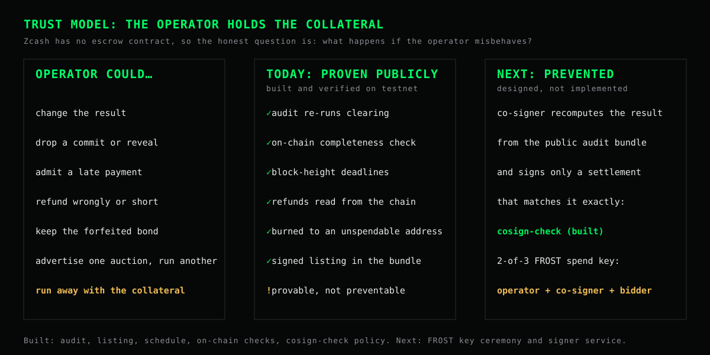

# On-chain settlement and public verification

DarkZec settles every auction on Zcash testnet in one transaction and then publishes the vault account's viewing key, so anyone can check from the chain alone that every deposit arrived and every zatoshi left the vault exactly as the cleared result says.

This page explains what that guarantees, what it does not, and the planned step that turns *detecting* a dishonest operator into *preventing* one.

## The trust model, plainly

Zcash has no smart contracts, so there is no escrow contract that releases collateral by itself. The operator's wallet holds the bidders' collateral between deposit and settlement. Therefore:

| Property | Before this change | Now |
| --- | --- | --- |
| Operator can change the result | Detected: the audit re-runs clearing and checks the operator's signatures | Same |
| Operator can ignore or censor a reveal | Detected: a signed acknowledgement proves the reveal was received | Same |
| Operator pays a refund wrong or keeps it | Not checkable: refunds were accounting only | **Detected publicly.** Every payout is on chain and is checked against the result (*Settlement on chain*) |
| Operator keeps forfeited collateral | Not checkable | **Detected publicly.** Forfeits go to a provably unspendable burn address |
| Operator runs away with the collateral | Possible | **Still possible, but provable:** anyone can show, from the published key, that the refunds never left the vault |
| Prevent theft altogether | No | No. That needs threshold custody (see [Next step](#next-step-threshold-custody-with-frost)) |

So DarkZec now gives **public, cryptographic evidence** of any settlement fraud, not just a suspicion. It does not yet make fraud impossible.

## How settlement works

1. **One vault account per auction.** The operator creates a fresh account in its wallet for each auction (`zcash-devtool wallet generate-account`). Bidders pay that account's address. Accounts from one seed use hardened ZIP-32 derivation, so their viewing keys are not linkable to each other.
2. **Clear and verify.** The auction clears in the browser terminal. `npm run settle` first re-runs the full audit on the bundle and refuses to settle a bundle that does not verify.
3. **One settlement transaction**, built from a multi-payment [ZIP-321](https://zips.z.cash/zip-0321) request and computed only from the verified result:

| Output | Amount | Memo |
| --- | --- | --- |
| Refund to each bidder's refund address | collateral − payment | `{"v":1,"t":"refund","a":<auction>,"c":<commitment>}` |
| Proceeds to the seller | sum of all payments | `{"v":1,"t":"proceeds","a":<auction>}` |
| Burn | every forfeited collateral | none (transparent output) |

   The fee comes from the reveal payments (0.0001 ZEC each). If they do not cover it, the operator first tops the vault up with a payment tagged `{"v":1,"t":"fee","a":<auction>}`.
4. **Publish.** The settlement record (viewing key, birthday height, seller address, txid) is attached to the audit bundle. The signed parts of the bundle do not change.

```bash
npm run settle -- --bundle cleared.json --wallet <vault wallet> --account <auction account uuid> --identity <age key> --seller <utest1…>
npm run settle -- … --send          # broadcast; without --send it only shows the wallet's proposal and fee
npm run verify-chain -- settled.json  # anyone: rebuild a view-only wallet from the key and run all ten checks
```

Both scripts use [zcash-devtool](https://github.com/zcash/zcash-devtool); set `DARKZEC_DEVTOOL_BIN` to its binary.

### The burn address

Forfeited collateral is sent to the P2SH address of the one-byte script `OP_RETURN` (`0x6a`). Spending a P2SH output requires a redeem script that hashes to the address and then runs successfully; `OP_RETURN` always fails, so no one can ever spend these coins, including the operator. Anyone can recompute the address:

```text
address = Base58Check(P2SH prefix ‖ RIPEMD160(SHA256(0x6a)))
testnet: t2CYfLDri6rrH4WSuXtHiu1WMWus6kFY2Ea
mainnet: t3QZUHYkaEQEuWosAc9HgMPKiQRdvuBPCQZ
```

`tests/settlement.test.ts` recomputes both with Node's own hash functions.

## Verifying on chain

A unified full viewing key lets a wallet decrypt notes sent to the account (incoming viewing key) and outputs the account sent (outgoing viewing key), and see when the account's notes are spent. It cannot spend.

`npm run verify-chain` (or Audit mode on a local DarkZec server) builds a view-only light wallet from the published key with `zcash-devtool wallet init-fvk`, then runs `sync` and `enhance` against a public light wallet server. It adds two checks to the eight off-chain ones:

- **Deposits on chain.** The key sees payments to the auction's vault address, which proves it is the vault's key. Every commitment arrived as exactly one confirmed payment of the collateral with its commit memo, and every accepted reveal arrived as a memo. For an auction run from a listing it also enforces the signed block-height deadlines in both directions: no counted payment is late, and no on-time commit or acceptable on-time reveal was left out ([auction links](auction-links.md#why-the-deadlines-are-block-heights)).
- **Settlement on chain.** Every refund, the proceeds and the burn were paid with the exact amount, recipient and memo implied by the verified result, and nothing else left the vault.

On the public site there is no light client, so Audit mode re-runs these two checks against the chain snapshot recorded when the run was verified, and says so in its verdict: the on-chain rows read **PASS (RECORDED)** in amber and the verdict calls it "a recording, not an independent live read". Only `npm run verify-chain`, or Audit mode on a local server, reads the chain independently. Without either source the checks are reported as **skipped**, never as passed.

## What publishing the viewing key reveals

The key is published **only after clearing and settlement**. Publishing it during the reveal window would leak bids early.

It reveals:
- every commit memo (an auction ID and a hash);
- every reveal memo (price, quantity, salt, refund address);
- the payouts.

Revealed bids are already published in the audit bundle after clearing, so this adds no new bid data. Collateral is a fixed tier, so deposit amounts reveal nothing either.

It does not reveal who paid: shielded senders stay hidden. It also does not reveal anything about the bidders' own wallets, or about the operator's other accounts.

Because each auction has its own account, anything sent to that account later would also be visible. It must not be reused.

## Next step: threshold custody with FROST



To make theft impossible rather than provable, the vault account's spend authority would be split with [FROST](https://frost.zfnd.org/) (re-randomized RedPallas, which Orchard and Ironwood spends use), for example 2-of-3 between the operator, an independent co-signer and a bidder-appointed party:

1. The participants generate the spend key with distributed key generation. Each of them, and the public, can hold the full viewing key.
2. After clearing, the operator builds the settlement as a partially created Zcash transaction (PCZT, supported by `zcash-devtool pczt`).
3. A co-signer signs only after recomputing the allowed payments from the verified audit bundle and checking that the proposal's outputs match them exactly.
4. Any spend that does not follow the published result then lacks a second signature and cannot be made.

**What is built:** step 3, the co-signer's policy. `src/lib/cosigner.ts` parses a settlement request (ZIP-321, multi-payment), re-verifies the audit bundle, recomputes the exact refunds, proceeds and burn, and approves only an exact match: the same recipients, amounts and memos, and nothing else. It refuses an already settled auction and a bundle that does not verify. `npm run cosign-check -- <bundle> --uri <request> --seller <address>` runs it, and `npm run settle` applies it to its own request before sending. Tests cover short refunds, a diverted burn, an extra payout, a dropped refund, a changed memo and a redirected refund.

**This is not independent custody.** `settle` runs the same policy on its own request, so it catches mistakes, not a dishonest operator who skips the script: the operator's wallet can still sign any spend. The check only becomes a control once someone else holds a required signature.

**What is not built:** the key ceremony, the threshold signing protocol and a signer service. They need their own review, and mainnet stays disabled until they exist.
